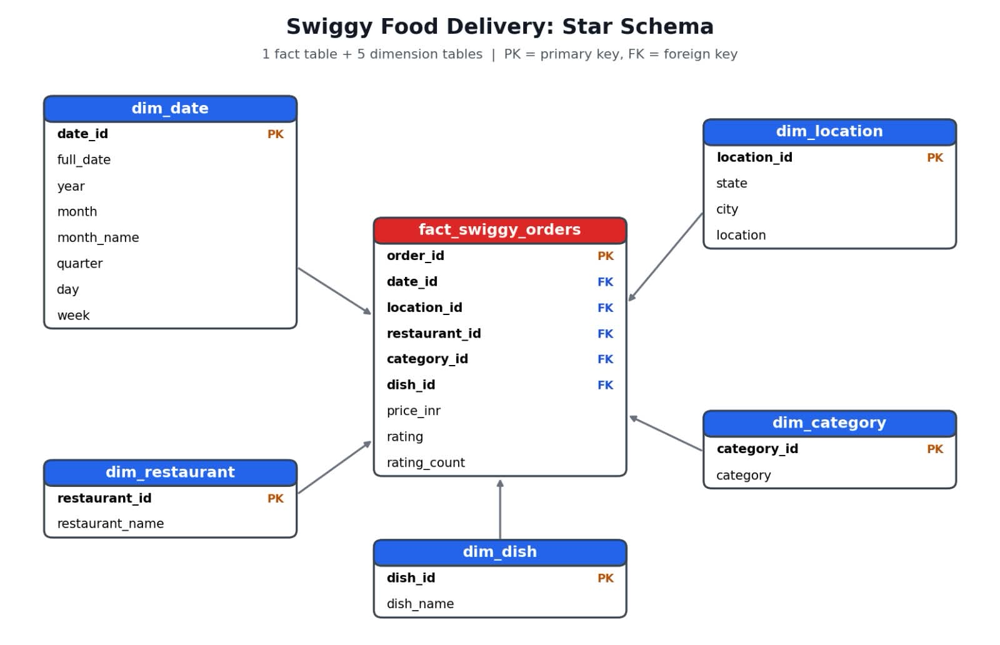

# Swiggy Food Delivery Analysis (MySQL)

End-to-end SQL project on roughly 1.97 lakh Swiggy food orders. It covers data cleaning, star schema design, KPIs and business analysis.

## Project Objective
Clean the raw order data, model it as a star schema, and use SQL to understand which cities, states, restaurants and dishes perform best, and in which price range most orders fall.

## Dataset
- File: `Swiggy_Data.csv`
- Rows: 1,97,430 (1,97,403 after removing duplicates)
- Period: 1 January 2025 to 31 August 2025
- Coverage: 28 states, 28 cities, 993 restaurants
- Columns: State, City, Order Date, Restaurant Name, Location, Category, Dish Name, Price (INR), Rating, Rating Count

## Tools
- MySQL / MySQL Workbench

## Repository Structure
```
Swiggy-data-sql-analysis/
├── README.md
├── swiggy_Data_Query.sql
├── Swiggy_Data.csv
└── star_schema.png.jpeg
```

## Project Steps

### 1. Data Cleaning
- Checked every column for NULL values: none found
- Checked for blank / empty strings
- Detected duplicate rows and removed them with the `row_number()` window function: 27 duplicate rows removed

### 2. Star Schema Design
One fact table and five dimension tables.



| Table | Type | Columns |
|---|---|---|
| fact_swiggy_orders | Fact | order_id, date_id, price_inr, rating, rating_count, location_id, restaurant_id, category_id, dish_id |
| dim_date | Dimension | date_id, full_date, year, month, month_name, quarter, day, week |
| dim_location | Dimension | location_id, state, city, location |
| dim_restaurant | Dimension | restaurant_id, restaurant_name |
| dim_category | Dimension | category_id, category |
| dim_dish | Dimension | dish_id, dish_name |

### 3. KPIs

| KPI | Value |
|---|---|
| Total Orders | 1,97,403 |
| Total Order Value | 53.0 INR Million |
| Average Dish Price | 268.5 INR |
| Average Rating | 4.34 |

### 4. Business Analysis
- Monthly and quarterly order trends
- Orders by day of the week
- Top 10 cities by order volume
- State-wise revenue contribution
- Top 10 restaurants by orders
- Most ordered dishes
- Category performance (orders and average rating)
- Customer spend buckets: Under 100, 100-199, 200-299, 300-499, 500+

## Key Insights
- **Bengaluru leads by a wide margin:** about 20,072 orders, while most other cities have 10,000 to 10,500. That is nearly double the second-largest city (Mumbai, 10,507).
- **Karnataka contributes the most order value:** 5.46 INR Million, roughly 10% of the 53.0 Million total. Uttar Pradesh (3.12 M) and Maharashtra (3.02 M) follow.
- **Fast-food chains dominate:** McDonald's (13,528 orders), KFC (12,957) and Burger King (7,115) are the top three restaurants.
- **Slight weekend lift:** Saturday (28,933) and Sunday (28,470) have the most orders, but the gap is small. Tuesday is lowest (27,413).
- **Most orders fall in the 100-299 INR range:** 56,369 orders in 100-199 and 54,773 in 200-299, about 56% of all orders. Only 15,697 orders are 500+.
- **Most popular dish:** Choco Lava Cake (303 orders), followed by Veg Fried Rice (243) and Chicken Sausage (227).
- **Ratings are very consistent:** category average ratings range from 4.30 to 4.46, with Sweets (4.46) at the top.
- **January 2025 is the busiest month:** 25,393 orders, followed by August (25,227) and May (25,188).

## Limitations
- The data covers January to August 2025 only, so there is a single year in the yearly trend and only two months in Q3.
- There is no customer ID in the dataset, so customer-level analysis (for example, top customers) is not possible.
- "Order value" means the listed dish price, not the actual bill (delivery fee, taxes and discounts are not included).

## SQL Concepts Used
JOINs, GROUP BY, CASE WHEN, window function (`row_number`), aggregate functions, date functions (`year`, `month`, `quarter`, `dayname`), foreign keys, star schema modelling

## How to Run
1. Create a table named `swiggy_data` in MySQL and import `Swiggy_Data.csv`.
2. Run `swiggy_Data_Query.sql` from top to bottom.

## Author
[आपका नाम] | [LinkedIn profile link] | [GitHub: sachin-lit](https://github.com/sachin-lit)
